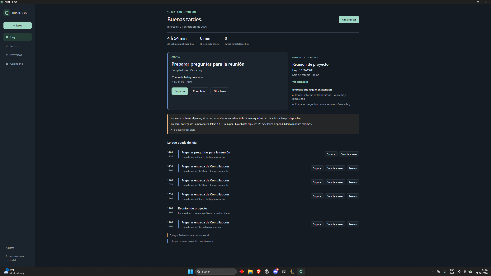
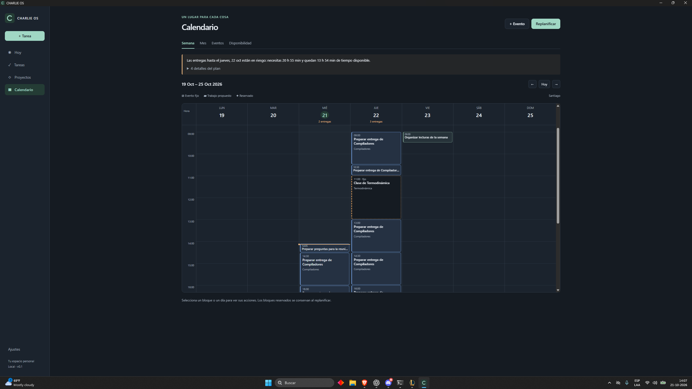
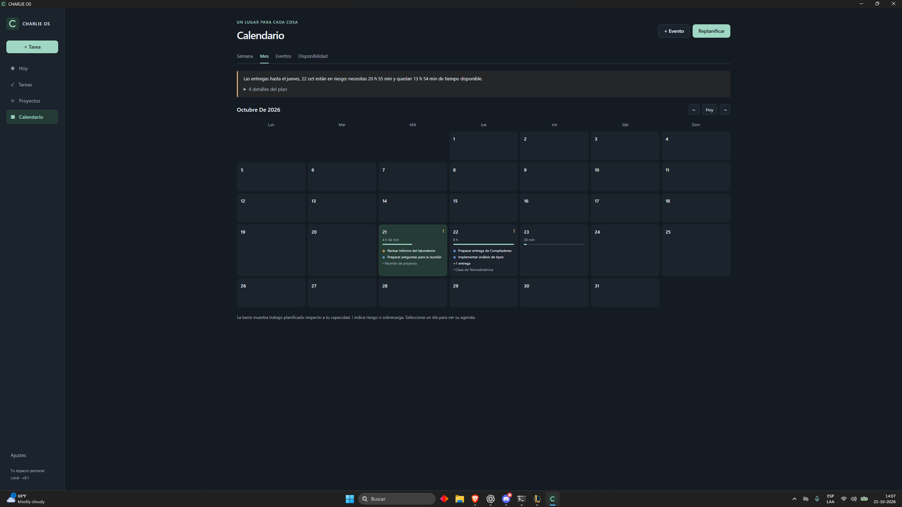

# CHARLIE OS

A local-first desktop productivity system that turns tasks, deadlines, estimates, availability, and fixed commitments into an executable schedule.



## Why I built it

A task list tells you what is pending; a calendar tells you when you are busy. CHARLIE brings those two views together to answer **“What should I work on now?”** and make an overloaded day visible before it becomes a missed deadline.

## Current capabilities

- **Tasks and projects:** quick task capture, deadlines, estimates, priorities, status filters, and project colors.
- **Time tracking:** start, stop, and complete tasks, with one active timer and persistent recorded work.
- **Planning:** weekly availability, fixed local events, deterministic scheduling and replanning, split work blocks, locked reservations, and capacity/overload warnings.
- **Daily workspace:** Today command center, visual Week timeline, and Month overview with deadlines and workload.
- **Local persistence:** SQLite storage, versioned migrations, and saved appearance/planning preferences. Spanish desktop UX with Santiago time handling.

## How scheduling works

On **Planificar / Replanificar**, the engine:

1. Expands weekly availability into Santiago dates, then subtracts fixed events and preserved reservations.
2. Orders eligible tasks by deadline, then priority/risk and stable tie-breakers. Blocked tasks and unfinished prerequisites prevent scheduling; undated tasks remain eligible.
3. Fits remaining work into the earliest available intervals as `PlanBlock`s of up to 90 minutes, respecting splitting and minimum-block rules.
4. Preserves past, ongoing, and locked future blocks; replaces only unlocked future work; reports conflicts and work that cannot fit.

The default horizon is 42 days, configurable from 1–90. This is a deterministic greedy heuristic, not a global optimizer. Missing estimates use a disclosed 30-minute assumption. Proposed blocks never count as completed work, and the planner never changes estimates or deadlines to make a plan fit. [Algorithm and edge cases](docs/MILESTONE_2.md).

## Architecture and engineering decisions

```text
React views → application services → typed Tauri IPC → Rust services → SQLite
                     ↓
          pure TypeScript planning engine
```

- **SQLite is authoritative.** React displays replaceable snapshots. Rust validates writes and commits state changes transactionally.
- **Planning is reproducible.** Domain code has no React or persistence dependency and accepts an explicit clock.
- **Concurrent changes are checked.** Workspace revisions reject stale schedule writes; database constraints enforce a single active timer.
- **Time has explicit semantics.** UTC instants, local dates, and date-only deadlines are distinct. Availability accounts for Santiago DST gaps and repeated hours.

### Where AI fits

**No LLM or external integration is connected today.** CHARLIE intentionally separates deterministic planning and structured persistent state from future AI functionality. Future AI could interpret natural language, surface context, explain choices, and propose actions; domain code would enforce scheduling and state invariants while SQLite remains the source of truth.

This separation makes proposals inspectable and testable, keeps the core workflow usable offline, and allows a future model provider to change without replacing the scheduling or persistence rules.

## Tech stack

Tauri 2 · React 19 · TypeScript · Rust · SQLite (`rusqlite`) · Vite · Tailwind CSS · Temporal · Vitest

## Screenshots

Real desktop captures using fictitious demo data. Today appears above; Week shows proposed work around fixed events, and Month summarizes deadlines and planned workload. See the [capture guide](docs/assets/README.md) to reproduce the demo.





## Running locally

Windows development prerequisites: Node.js 22.18+ within the range in `package.json`, pnpm 11.19.0, stable Rust with the MSVC toolchain, Microsoft C++ Build Tools, a Windows SDK, and WebView2.

```powershell
pnpm install --frozen-lockfile
pnpm tauri dev
```

The desktop backend is required; a browser-only Vite session cannot load or persist tasks. No API keys or account are required. For an isolated demo, use the [fictitious seed instructions](docs/assets/README.md). See the [development guide](docs/DEVELOPMENT.md) for database location, timer behavior, packaging, and the full validation commands.

## Tests and quality

The current suite contains 60 TypeScript tests and 27 Rust integration tests (87 total).

Vitest covers deterministic scheduling, deadlines, splitting, capacity, protected blocks, and Santiago DST. Rust integration tests use temporary databases to cover migrations, persistence, timer exclusivity, validation, and stale writes across connections.

```powershell
pnpm test
cargo test --locked --manifest-path src-tauri/Cargo.toml
```

Type checking, production build, linting, formatting, Cargo check, and Clippy complement these tests. The [daily UX verification record](docs/MILESTONE_3.md#native-desktop-verification-and-remaining-checks) records completed manual checks on the new PC for quick task creation, task and theme persistence, reduced-window usability, and native app restart, alongside the scope of other verification.

## Roadmap

Future work, **not implemented**: natural-language task capture, AI-assisted reasoning and explanations, Google Calendar, Gmail, Drive, and progressively automated ingestion with user review.

The [product specification](docs/PRODUCT_SPEC.md) records the longer-term direction. Engineering records document [task persistence](docs/MILESTONE_1.md), [scheduling](docs/MILESTONE_2.md), and [daily UX](docs/MILESTONE_3.md). Contributor guidance lives in [AGENTS.md](AGENTS.md).
